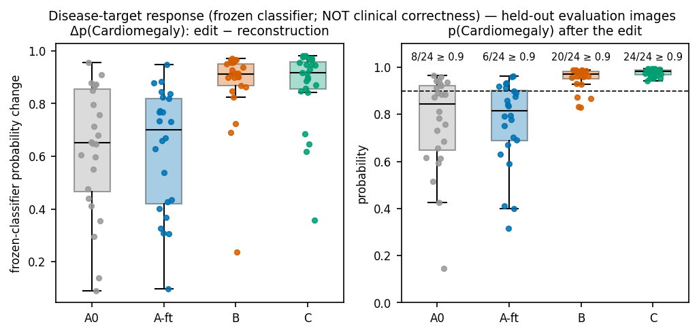
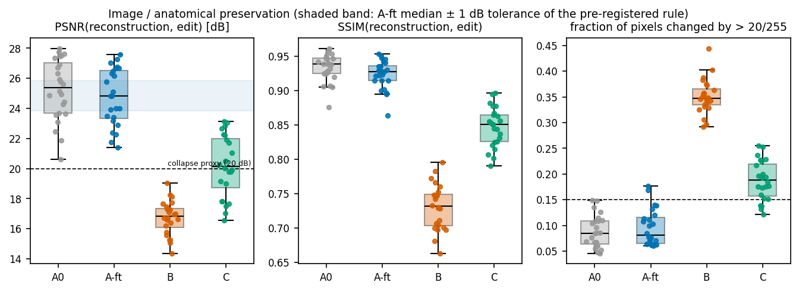
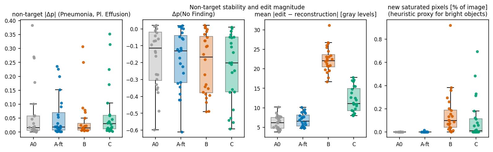
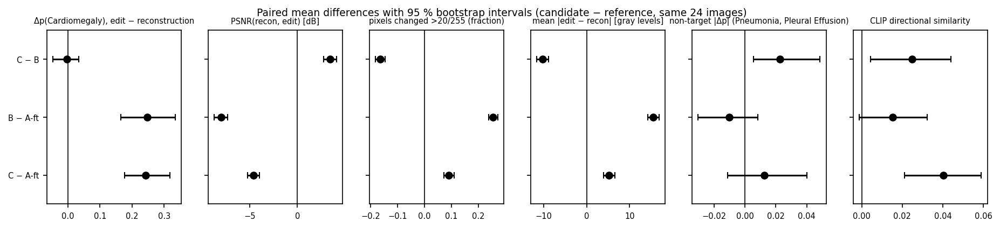
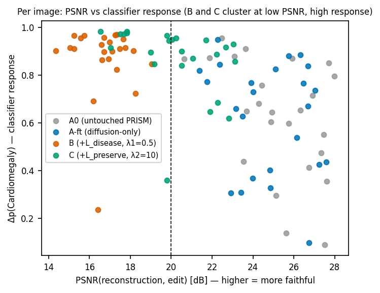

# Disease-consistency and anatomical-preservation constraints for counterfactual chest X-ray generation — final research report

**Status of the claim: the hypothesis was not supported under the tested conditions.** Every number below is rebuilt from the saved Kaggle artifacts by `scripts/phase8_report.py` (no model was retrained and no counterfactual regenerated for this report); the generated tables are embedded between `BEGIN/END` markers and a test checks that they equal `docs/results/tables.md`. Generated images are synthetic and must never be read as clinical images, ground truth, diagnoses or recommendations.

**Evidence labels.** **MEASURED** = computed from saved outputs (and recomputed from the saved PNGs for this report); **ESTIMATED** = a statistical estimate of uncertainty (bootstrap intervals, rank-test p-values); **QUALITATIVE** = human visual review, not a metric. Anything not labelled is a description of design or procedure.

## 1. Question

Can explicit disease-consistency (`L_disease`) and anatomical-preservation (`L_preserve`) constraints improve the clinical reliability of diffusion-based counterfactual medical image generation while maintaining image fidelity and useful visual quality? (`CLAUDE.md` section 9.) Chest X-rays, CheXpert; edit tested: "add Cardiomegaly".

## 2. Method (as run)

- **Baseline.** PRISM (language-guided Stable Diffusion editing; Kumar et al.). The official repository omits its editing modules (`docs/PHASE_1_AUDIT.md`), so null-text inversion + Prompt-to-Prompt attention control are **our reconstruction**; the PRISM CheXpert-fine-tuned checkpoint (SHA-256-verified) is the authors'. Editing: 512 px, 30 DDIM steps, 5 inner null-text steps, `self_replace_steps` 0.2, `cross_replace_steps` 0.8, edit-word weight 2.0, seed 42.
- **Frozen classifier `C`.** DenseNet121 trained by us on real CheXpert (100k frontal images, patient-level split, `ignore` policy): held-out macro-AUROC 0.833 (Pneumonia 0.723 is the thin margin) — `docs/PHASE_5_REAL_DATA_GATE.md`. It supplies `L_disease`, the feature extractor of `L_preserve`, and the evaluation score. Pinned by SHA-256 `d14a9e87…763a`.
- **Four arms (same 24 test-patient images, same editing settings).** **A0** untouched PRISM checkpoint; **A-ft** diffusion-loss-only fine-tuning (the control for "any extra fine-tuning"); **B** = A-ft recipe + λ1·`L_disease` (λ1 = 0.5 from a pre-registered rule); **C** = B + λ2·`L_preserve` (λ2 = 10 from a pre-registered gradient-balance rule). `L_disease` = masked multi-label BCE of `C` on the VAE-decoded one-step estimate x̂0 (samples with t < 500); `L_preserve` = LPIPS-style distance between the early/mid blocks (`denseblock1/2`) of `C` for the real image and for x̂0.
- **Fine-tuning recipe (identical for A-ft, B, C).** Attention projections only (93.5M of 859.5M U-Net parameters), 600 optimizer steps (4,800 images, effective batch 8), lr 2e-5, fp16 + gradient checkpointing, validation-split patients (disjoint from the classifier's training patients and from the evaluation patients).
- **Evaluation.** 24 images, one per patient, from **test-split patients** (frontal, "No Finding" = 1, other three labels 0 or unmentioned), `patient33038` excluded; operation add Cardiomegaly. Metrics: frozen-classifier Δp (edit − reconstruction), image preservation (PSNR, SSIM, fraction of pixels changed by > 20/255, brightness shift), edit magnitude (mean |edit − reconstruction|), non-target stability (|Δp| of Pneumonia and Pleural Effusion), CLIP directional similarity, a collapse proxy (PSNR < 20 dB) and a heuristic bright-object proxy, plus a manual visual review. Paired comparisons use the same images; intervals are 95 % bootstrap (10,000 resamples of images, seed 0) with Wilcoxon signed-rank p-values as a sensitivity check (**ESTIMATED**).
- **Pre-registered rules.** Written before each result and applied literally (`docs/PHASE_6_…md`, `docs/PHASE_7_…md`): effect, preservation (PSNR ≥ A-ft − 1 dB, pixels changed ≤ A-ft + 0.05, |brightness| < 5), non-target stability, CLIP, collapse proxy, visual review.

## 3. Results (24 held-out images; one seed; attention-only fine-tuning)

### 3.1 Per-arm summary — MEASURED

<!-- BEGIN:summary -->
| median [IQR] over 24 images | A0 (untouched PRISM) | A-ft (diffusion-only) | B (+L_disease, λ1=0.5) | C (+L_preserve, λ2=10) |
|---|---|---|---|---|
| Δp(Cardiomegaly), edit − recon | 0.65 [0.47, 0.86] | 0.70 [0.42, 0.82] | 0.91 [0.87, 0.95] | 0.92 [0.85, 0.96] |
| p(Cardiomegaly) after edit | 0.84 [0.65, 0.92] | 0.82 [0.69, 0.90] | 0.97 [0.95, 0.98] | 0.98 [0.97, 0.99] |
| PSNR(recon, edit) [dB] | 25.4 [23.7, 27.0] | 24.8 [23.3, 26.5] | 16.8 [16.1, 17.4] | 20.1 [18.7, 22.0] |
| SSIM(recon, edit) | 0.938 [0.925, 0.947] | 0.928 [0.914, 0.936] | 0.731 [0.703, 0.749] | 0.851 [0.825, 0.865] |
| pixels changed >20/255 | 0.085 [0.064, 0.109] | 0.081 [0.064, 0.116] | 0.348 [0.335, 0.366] | 0.189 [0.157, 0.219] |
| mean \|edit − recon\| [gray levels] | 6.2 [4.7, 7.5] | 6.6 [5.3, 8.2] | 22.1 [20.4, 23.7] | 11.1 [9.3, 14.9] |
| brightness shift [gray levels] | 1.52 [-0.66, 2.15] | 1.08 [-1.64, 2.72] | 2.64 [-0.46, 5.73] | 4.21 [-0.85, 7.04] |
| non-target \|Δp\| (Pneu., Pl. Eff.) | 0.016 [0.006, 0.058] | 0.018 [0.007, 0.070] | 0.015 [0.007, 0.031] | 0.030 [0.011, 0.060] |
| Δp(No Finding) | -0.113 [-0.306, -0.020] | -0.130 [-0.319, -0.040] | -0.166 [-0.378, -0.045] | -0.201 [-0.373, -0.049] |
| CLIP directional | 0.016 [-0.020, 0.046] | 0.003 [-0.014, 0.025] | 0.022 [0.008, 0.035] | 0.044 [0.023, 0.070] |
| inversion fidelity PSNR(orig, recon) [dB] | 27.7 [26.5, 29.2] | 27.8 [26.7, 29.1] | 26.1 [25.0, 26.8] | 26.7 [25.4, 27.8] |
| new saturated pixels [%] (heuristic) | 0.000 [0.000, 0.000] | 0.000 [0.000, 0.000] | 0.100 [0.040, 0.190] | 0.010 [0.000, 0.114] |
| edits crossing p = 0.5 (of 24) | 20 | 19 | 23 | 23 |
| edits with p after ≥ 0.9 | 8 | 6 | 20 | 24 |
| edits with PSNR < 20 dB (collapse proxy) | 0 | 0 | 24 | 11 |
| edits with PSNR < 22 dB | 2 | 2 | 24 | 18 |
| edits with > 15 % pixels changed | 0 | 2 | 24 | 20 |
<!-- END:summary -->





### 3.2 Paired comparisons (candidate − reference, same images) — MEASURED differences, ESTIMATED intervals and p-values

Forty-eight paired comparisons were computed (4 contrasts × 12 metrics; 32 are shown) without multiplicity correction, so p-values are descriptive (a Bonferroni threshold would be 0.05/48 ≈ 1e-3). The large effects (B − A-ft and C − A-ft on Δp, PSNR, SSIM, pixels changed; C − B on PSNR, SSIM, pixels changed) have p ≤ 7e-6 and would survive it; the small ones (e.g. A-ft − A0 PSNR p = 0.02, C − B non-target p = 0.02) would not.

<!-- BEGIN:paired -->
| candidate − reference | metric | mean difference | 95 % bootstrap CI | Wilcoxon p | candidate higher / lower (of 24) |
|---|---|---|---|---|---|
| A_ft − A0 | Δp(Cardiomegaly), edit − reconstruction | -0.003 | [-0.051, +0.050] | 0.37 | 10 / 14 |
| A_ft − A0 | PSNR(recon, edit) [dB] | -0.472 | [-0.875, -0.036] | 0.021 | 7 / 17 |
| A_ft − A0 | SSIM(recon, edit) | -0.010 | [-0.016, -0.004] | 0.0096 | 7 / 17 |
| A_ft − A0 | pixels changed >20/255 (fraction) | +0.008 | [-0.002, +0.018] | 0.15 | 15 / 9 |
| A_ft − A0 | mean |edit − recon| [gray levels] | +0.670 | [+0.264, +1.058] | 0.0035 | 18 / 6 |
| A_ft − A0 | non-target |Δp| (Pneumonia, Pleural Effusion) | -0.009 | [-0.029, +0.009] | 0.55 | 10 / 14 |
| A_ft − A0 | CLIP directional similarity | -0.003 | [-0.026, +0.019] | 0.77 | 12 / 12 |
| A_ft − A0 | new saturated pixels [% of image] (heuristic proxy) | +0.001 | [-0.000, +0.002] | 0.21 | 5 / 1 |
| B − A_ft | Δp(Cardiomegaly), edit − reconstruction | +0.247 | [+0.165, +0.335] | 6.6e-06 | 23 / 1 |
| B − A_ft | PSNR(recon, edit) [dB] | -8.018 | [-8.714, -7.314] | 1.2e-07 | 0 / 24 |
| B − A_ft | SSIM(recon, edit) | -0.192 | [-0.205, -0.179] | 1.2e-07 | 0 / 24 |
| B − A_ft | pixels changed >20/255 (fraction) | +0.255 | [+0.239, +0.272] | 1.2e-07 | 24 / 0 |
| B − A_ft | mean |edit − recon| [gray levels] | +15.481 | [+14.251, +16.791] | 1.2e-07 | 24 / 0 |
| B − A_ft | non-target |Δp| (Pneumonia, Pleural Effusion) | -0.010 | [-0.031, +0.008] | 0.62 | 12 / 12 |
| B − A_ft | CLIP directional similarity | +0.015 | [-0.001, +0.032] | 0.12 | 16 / 8 |
| B − A_ft | new saturated pixels [% of image] (heuristic proxy) | +0.156 | [+0.091, +0.240] | 1.2e-07 | 24 / 0 |
| C − A_ft | Δp(Cardiomegaly), edit − reconstruction | +0.243 | [+0.177, +0.318] | 1.2e-07 | 24 / 0 |
| C − A_ft | PSNR(recon, edit) [dB] | -4.583 | [-5.220, -3.969] | 1.2e-07 | 0 / 24 |
| C − A_ft | SSIM(recon, edit) | -0.076 | [-0.089, -0.064] | 1.2e-07 | 0 / 24 |
| C − A_ft | pixels changed >20/255 (fraction) | +0.091 | [+0.072, +0.110] | 6e-07 | 22 / 2 |
| C − A_ft | mean |edit − recon| [gray levels] | +5.219 | [+3.921, +6.551] | 6e-07 | 22 / 2 |
| C − A_ft | non-target |Δp| (Pneumonia, Pleural Effusion) | +0.012 | [-0.011, +0.040] | 0.14 | 17 / 7 |
| C − A_ft | CLIP directional similarity | +0.040 | [+0.021, +0.059] | 0.00057 | 20 / 4 |
| C − A_ft | new saturated pixels [% of image] (heuristic proxy) | +0.102 | [+0.039, +0.179] | 0.00071 | 16 / 1 |
| C − B | Δp(Cardiomegaly), edit − reconstruction | -0.004 | [-0.046, +0.034] | 0.7 | 14 / 10 |
| C − B | PSNR(recon, edit) [dB] | +3.435 | [+2.755, +4.094] | 2.4e-07 | 23 / 1 |
| C − B | SSIM(recon, edit) | +0.116 | [+0.105, +0.127] | 1.2e-07 | 24 / 0 |
| C − B | pixels changed >20/255 (fraction) | -0.164 | [-0.182, -0.146] | 1.2e-07 | 0 / 24 |
| C − B | mean |edit − recon| [gray levels] | -10.262 | [-11.610, -8.873] | 1.2e-07 | 0 / 24 |
| C − B | non-target |Δp| (Pneumonia, Pleural Effusion) | +0.023 | [+0.005, +0.049] | 0.018 | 16 / 8 |
| C − B | CLIP directional similarity | +0.025 | [+0.004, +0.044] | 0.012 | 17 / 7 |
| C − B | new saturated pixels [% of image] (heuristic proxy) | -0.054 | [-0.138, +0.038] | 0.016 | 4 / 20 |
<!-- END:paired -->



### 3.3 Pre-registered rules — MEASURED

<!-- BEGIN:rules -->
| pre-registered rule (vs A-ft) | B (Phase 6) | C (Phase 7) |
|---|---|---|
| preservation (PSNR ≥ A-ft − 1 dB, pixels changed ≤ A-ft + 0.05, \|brightness\| < 5) | **fails** | **fails** |
| effect (mean Δp gain over A-ft ≥ +0.05, CI lower bound > 0) | holds | holds |
| non-target stability (≤ A-ft + 0.05) | holds | holds |
| CLIP directional (≥ A-ft − 0.02) | holds | holds |
| collapse proxy (≤ 2 edits below 20 dB) | n/a (24 of 24 below) | **fails** (11 of 24) |
<!-- END:rules -->

### 3.4 Classifier saturation — MEASURED (the Δp–PSNR correlation is ESTIMATED)

<!-- BEGIN:saturation -->
| arm | mean p after edit | mean headroom (1 − p) | edits p ≥ 0.9 | edits p ≥ 0.9 **and** PSNR < 22 dB | Spearman ρ(Δp, PSNR) [p] |
|---|---|---|---|---|---|
| A0 (untouched PRISM) | 0.766 | 0.234 | 8 | 1 | -0.46 [0.025] |
| A-ft (diffusion-only) | 0.764 | 0.236 | 6 | 1 | -0.17 [0.41] |
| B (+L_disease, λ1=0.5) | 0.951 | 0.049 | 20 | 20 | -0.14 [0.51] |
| C (+L_preserve, λ2=10) | 0.977 | 0.023 | 24 | 18 | -0.56 [0.0047] |
| all 96 edits pooled | | | 58 | 40 | -0.65 [1.2e-12] |
<!-- END:saturation -->



The frozen classifier's response is **not** a proxy for a correct edit. A0/A-ft already move p(Cardiomegaly) from ≈ 0.05 to ≈ 0.8 with moderate edits (mean headroom ≈ 0.24). B and C push it to 0.95–0.98 (24 of 24 edits ≥ 0.9 for C) while PSNR falls to 16.8 / 20.1 dB; across all 96 edits 58 reach p ≥ 0.9 and 40 of those have PSNR < 22 dB; the rank correlation between Δp and PSNR is −0.65 (pooled; within-arm values in the table). B was optimised against this very classifier, so its score is partly circular; C shares the classifier's representation in `L_preserve`. No independent evaluator was available (section 5).

### 3.5 Visual failure cases — QUALITATIVE (reviewer: the AI assistant, non-clinical)

<!-- BEGIN:visual -->
| visual review (QUALITATIVE; reviewer: Claude (AI assistant), non-clinical) | A0 | A-ft | B | C |
|---|---|---|---|---|
| regular scatter of small bright dots on the edit | not seen (8 reviewed) | 0 / 24 | 24 / 24 | 0 / 24 |
| lungs and mediastinum replaced by one large smooth bright mass (B-type collapse) | 0 / 8 reviewed | 0 / 24 | 24 / 24 | 0 / 24 (the lungs, ribs, spine and clavicles remain visible) |
| grossly exaggerated, smooth cardiac shadow filling a large part of the thorax | not seen (8 reviewed) | not seen | n/a (collapsed) | most images; extreme in 11 (2, 3, 6, 12, 13, 16, 17, 19, 20, 21, 22) |
| implanted-device-like object (pacemaker/ICD generator, leads) that is not in the original | not seen (8 reviewed) | not seen | some bright objects inside the collapsed mass (not separately counted) | 3 confirmed at full resolution (2, 11, 19); 3 less certain (8, 9, 15) |
| blob-like opacity on messy AP/portable images | 2 / 8 reviewed (indices 5, 6) | occasional, not counted | n/a (collapsed) | not separately counted |
<!-- END:visual -->

- **B (λ1 = 0.5)** collapses the thorax in all 24 edits: the lungs and mediastinum become one large smooth bright mass with a regular scatter of bright dots and erased ribs (the classifier output is nevertheless 0.97). The weighted disease gradient was 16× the diffusion gradient at initialisation.
- **C (λ2 = 10)** removes the dot pattern and the whole-thorax white-out in all 24 images and recovers 3.4 dB of PSNR relative to B (ribs, lungs, spine and clavicles remain visible), but still draws a grossly exaggerated, smooth cardiac shadow in most images (extreme in 11) and **hallucinates implanted-device-like objects** (pacemaker/ICD generators with leads in the left upper chest) that are in neither the original nor A-ft's edit: confirmed at full resolution in images 2, 11 and 19; less certain in 8, 9 and 15. The new-saturated-pixel proxy is a heuristic that also flags large bright masses (it ranks images 12, 14, 16, 21 first, none of which contains a device); it is not a device detector.
- Image sheets (original | A0 | A-ft | B | C | C difference map), all-24 contact sheets and device crops are produced under `experiments/phase8/` by the report script. They are built from CheXpert-derived outputs and are **never committed** (git-ignored).

### 3.6 Compute and verification — MEASURED (from the saved run artifacts)

<!-- BEGIN:compute -->
| arm | steps | s/step | wall-clock [min] | peak GPU [GB] | skipped steps | clip fraction | final L_diffusion | final L_disease | final L_preserve |
|---|---|---|---|---|---|---|---|---|---|
| A_ft | 600 | 3.7 | 38 | 6.54 | 0 | 0.000 | 0.136 | - | - |
| B | 600 | 6.9 | 69 | 11.76 | 0 | 0.110 | 0.145 | 0.056 | - |
| C | 600 | 7.1 | 71 | 11.75 | 0 | 0.865 | 0.156 | 0.159 | 0.149 |

| evaluation arm | minutes for the evaluation set | peak GPU [GB] |
|---|---|---|
| A0 | 75 | 11.0 |
| A_ft | 75 | 11.0 |
| B | 70 | 11.0 |
| C | 71 | 11.0 |
<!-- END:compute -->

Session wall-clock from the saved Kaggle console logs (not stored in the repository): Phase 5 ≈ 11 + 7 + 34 min, Phase 6 ≈ 30 min + 3.8 h, Phase 7 ≈ 2.5 h (about 7.7 h for these sessions; Phase 4 and one repeated 6-minute run excluded). Training used one T4 per arm (the two T4s of a Kaggle session ran A-ft and B in parallel, for training and for evaluation).

<!-- BEGIN:verification -->
| check | result |
|---|---|
| frozen classifier hash = pinned `d14a9e87…763a` | pass |
| evaluation set identical in Phase 6 and Phase 7 (SHA-256 of `eval_set.json`) | pass |
| all four arms scored on the identical images/folders; original images byte-identical across arms; metadata image paths match | pass |
| evaluation-run configs differ only in arm identity (delta path, run name, cache dir) | pass |
| training configs of A-ft/B/C differ only in the loss block and identity; `finetune` block identical (except the C-only `anatomy.layers` key) | pass |
| evaluation patients ⊂ test split; disjoint from fine-tuning (val) and classifier-training (train) patients; `patient33038` absent | pass |
| every image metric recomputed from the saved PNGs matches the stored score (tolerances: 1e-6 PSNR/SSIM, 2e-3 probabilities) | pass |
| bootstrap/rule implementations agree with the Phase 6 artifact and with `compare_arms.py` | pass |
| run manifests `completed` and per-run `artifacts.json` hashes verified (7 runs) | pass |
| Kaggle zip SHA-256 = hash printed by the notebook | pass |
| code package hash recorded in every run = the package uploaded for that phase | pass |
<!-- END:verification -->

Every image metric recomputed from the saved PNGs agrees with the stored per-image scores to ≤ 3e-7 (probabilities) and ≤ 4e-15 (PSNR/SSIM/pixel statistics); CLIP values were measured during the Kaggle runs and are not recomputed offline. The delta checkpoints (> 50 MB) are not in the downloaded artifacts; their SHA-256 values are recorded in each run's `finetune_summary.json` but could not be re-hashed.

## 4. Why the hypothesis was not supported (under these conditions)

1. **B (disease consistency alone, λ1 = 0.5)** raised the classifier response over A-ft by +0.25 (CI +0.17 … +0.33) but at the price of destroyed images: PSNR −8.0 dB, 35 % of pixels changed, B's collapse signature on 24 of 24 edits. The effect is a classifier-specific response, not evidence of a better counterfactual; it fails the preservation and visual rules.
2. **C (B + preservation, λ2 = 10)** moved in the intended direction relative to B (+3.4 dB, SSIM +0.12, 16 points fewer pixels changed, dot artifacts gone) without changing the classifier response, but did not restore A-ft's preservation (−4.6 dB, +9 points of pixels changed), failed the collapse proxy (11 of 24 below 20 dB) and the visual check (exaggerated cardiac shadow, hallucinated devices).
3. **The control matters:** A-ft alone changed the classifier response by nothing measurable (−0.003, CI −0.05 … +0.05) and was slightly less faithful than A0 (−0.47 dB, SSIM −0.010; small, CI excludes 0), so fine-tuning is not the source of B's/C's effect; the auxiliary losses are.
4. **No tested arm** both increased the classifier response beyond A-ft and met the pre-registered preservation tolerance; where the response rose, fidelity fell. The classifier saturates (A-ft already reaches p ≈ 0.8, leaving little headroom), so a higher score cannot be read as higher clinical reliability. The hypothesis is therefore **not supported** — which is weaker than "refuted": see the limitations.
5. A plausible mechanism, **not tested**: with the one-shot weights, gradient clipping engaged on 86.5 % of C's steps (B 11 %, A-ft 0 %), so the auxiliary gradients dominated the update and the diffusion loss — the term that keeps the generator a good image model — contributed little.

## 5. Limitations (what the conclusions are limited to)

One seed; 24 held-out images (24 patients); one edit operation (add Cardiomegaly; "remove" and the other pathologies untested); attention-only fine-tuning of 600 steps (not PRISM's 100-epoch full fine-tuning); one λ1 (from a loss-ratio rule that turned out to give a 16× gradient imbalance) and one λ2 (from a one-shot gradient-balance rule); no λ sweep, by design — a different weight, clip or schedule might behave differently and is not claimed to fail. The classifier is imperfect (labels are automatic-labeler outputs, ≈ 99 % of Pneumonia negatives are "unmentioned"), exploitable (shown here), also the source of `L_preserve`'s features, and the only disease evaluator: **no independent classifier, no LPIPS, FID/KID or downstream-utility experiment** was run (they need new models or training, outside this phase's boundaries). The visual review is mine and non-clinical (reduced size for most images; full resolution only for those named); the bright-object proxy is an unvalidated heuristic. A0 was visually reviewed on 8 of 24 images only. The editing pipeline is our reconstruction of PRISM, CheXpert-small images (≈ 390 × 320) are squashed to 512² for fine-tuning but center-cropped for inversion (inherited preprocessing mismatch, identical across arms), the PRISM checkpoint's own training split is unknown (our test patients may have been seen), and A-ft/B were trained with the earlier code package while C used the revised fine-tuning module (equivalence of the B code path is tested on CPU — C(λ2 = 0) reproduces B — but was not rerun on GPU). Statistics are descriptive and uncorrected for multiplicity.

## 6. Deviations from PRISM (original vs. ours)

PRISM-side entries are facts read from the official repository's code (`docs/PHASE_1_AUDIT.md`); paper-level claims were not re-verified here.

| aspect | PRISM (official code) | this project |
|---|---|---|
| editing modules (inversion, Prompt-to-Prompt) | not in the public repo | **reconstructed** (Phase 3), not PRISM's code |
| fine-tuning | full U-Net, batch 8 × accumulation 4 (× GPUs), 100 epochs, lr 1e-5, fp16, 512 px CheXpert | **attention projections only (10.9 %)**, 600 steps, effective batch 8, lr 2e-5, fp16, CheXpert-small upsampled to 512 px |
| null-text inner steps / DDIM steps | 10 inner steps | 5 inner steps, 30 DDIM steps (compute) |
| `self_replace_steps` | swept over 0.4–0.8 | 0.2 (outside the swept range; chosen from a one-image calibration, 0.0 and 0.4–0.8 also tried there) |
| novelty losses | none (baseline) | `L_disease` (B), `L_preserve` (C), frozen classifier |
| data | CheXpert (full) | CheXpert-small (11 GB public copy), 100k-image classifier subset, 24-image evaluation set |

## 7. Reproducing this report

```bash
python scripts/phase8_report.py --phase6-op "<Phase 6 v2 output dir>" --phase7-op "<Phase 7 output dir>" \
    --classifier "<phase5 classifier best.pt>" --label-csv "<phase5/train_resolved.csv of the Phase 5b output>" \
    --phase6-zip "<zip>" --phase7-zip "<zip>" --phase6-log "<console log>" --phase7-log "<console log>" \
    --update-report docs/FINAL_RESEARCH_REPORT.md
```

It verifies the artifacts (section 3.6), recomputes the metrics, rewrites `docs/results/*` and the table blocks above, and exits non-zero if any check fails. Two runs on the same artifacts give byte-identical `results.json`, `tables.md` and `verification.json` (tested on a synthetic artifact tree and checked on the real one). The saved artifacts live outside the repository (they contain CheXpert-derived images); their SHA-256 values are listed in `docs/results/artifact_manifest.json`.
