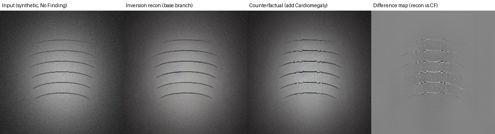
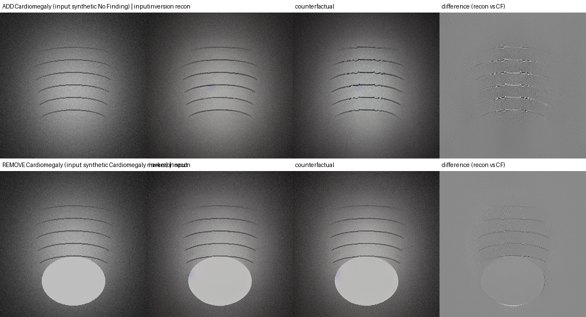

# Phase 3 — PRISM Baseline Reproduction

Status date: 2026-10-13. Builds on [PHASE_1_AUDIT.md](PHASE_1_AUDIT.md) and [PHASE_2_DATASET_CLASSIFIER.md](PHASE_2_DATASET_CLASSIFIER.md).

## Status: PARTIAL

| Gate item | Result |
|---|---|
| Missing PRISM functionality reconstructed | **Done** — `src/models/prism/` (5 modules), reconstructed from the published methods, not from PRISM's source |
| Pipeline runs end-to-end with the real PRISM checkpoint | **Yes** — `add` and `remove` both run on this CPU (642 s and 574 s uncached) |
| Checkpoint verified | **Yes** — size and SHA-256 match the Hub; strict-loads into the SD v1.5 UNet |
| Output validated (dims, range, NaN, timings) | **Yes** |
| Requested pathology change visible | **No, for either operation** — `add Cardiomegaly` preserved the image but drew no cardiomegaly; `remove Cardiomegaly` left the synthetic cardiomegaly marker intact (section 8b) |
| Unrelated anatomy preserved | **Yes** for both (0.07–1.1 % of pixels changed by >20/255) — but largely because the edits are weak, not because the blend is selective |
| LocalBlend | runs for both operations after the closure fix; mask covers ~98 % of the image for `add` (near-inert) and ~48 % for `remove` |
| Tests | 67/67 pass |
| Phase 3 doc | this file |

**What this phase does and does not establish.** It establishes that the reconstructed pipeline executes with PRISM's actual weights, behaves correctly on the invariants we can test (an identity edit is an exact no-op; the edit is small and structure-preserving), and is reproducible (bit-identical reruns). It does **not** establish that the reconstruction reproduces PRISM's *edit quality*: neither real generation (`add`, `remove`) showed the requested pathology change. That could be the reconstruction, the synthetic out-of-distribution input, the reduced resolution/steps, or all three — the experiments here cannot separate them, and no real CheXpert image was available to try. All of this is pipeline validation on synthetic data, **not** medical validation.

## 1. What was missing from the official repository

Recap of [PHASE_1_AUDIT.md](PHASE_1_AUDIT.md) section A: the official `Amarkr1/PRISM@8c6c642` imports four modules it never committed — `utils/misc_utils.py`, `utils/edit_utils.py`, `utils/inference_utils.py`, `generate_captions.py` — so `generate_cf_images.py` cannot run (confirmed by upstream issue #5). Those modules would have supplied `NullInversion`, `AttentionStore`, `make_controller`, `run_and_display`, and `ClipSimilarity`.

## 2. What was reconstructed, and from what

**Important provenance statement.** None of this is PRISM's code. It was written from the published algorithm descriptions and general knowledge of the techniques, using PRISM's own *calls* to the missing modules (in `generate_cf_images.py`) as the interface specification. It was **not** copied from, or diffed line-by-line against, any reference implementation (no reference repository was fetched in this phase).

| Component | File | Reconstructed from |
|---|---|---|
| Null-text inversion (DDIM inversion + per-step null-embedding optimization) | `src/models/prism/null_inversion.py` | Mokady et al. 2023 (cited in PRISM's Acknowledgements); call signature from PRISM's code |
| Attention control: store / refine / reweight / local blend / `make_controller` | `src/models/prism/attention_control.py` | Hertz et al. 2022 Prompt-to-Prompt (cited in PRISM's Acknowledgements); parameter names from PRISM's code |
| Attention hook (`AttnProcessor`), sampling loop (`run_and_display` equivalent), VAE decode | `src/models/prism/ptp_utils.py` | same; diffusers 0.24.0 `AttnProcessor` API (inspected in the installed package) |
| Word↔token mapping, caption alignment, equalizer | `src/models/prism/token_alignment.py` | Hertz et al. 2022 (concept); algorithm is our own construction |
| CLIP image/text/directional similarity | `src/models/prism/clip_similarity.py` | PRISM's call shape; StyleGAN-NADA-style directional similarity |
| Clean inference interface | `src/inference/prism_baseline.py` | project requirement (Phase 3 spec) |

## 3. Verified vs reconstructed vs unverified

**VERIFIED FROM OFFICIAL CODE** (read directly in `finetune_chexpert.py` / `generate_cf_images.py`):
- VAE and text encoder frozen, UNet trainable; epsilon-prediction MSE loss; caption convention (`"Chest X-ray showing X"` / `"Normal chest X-ray with no significant findings"`).
- The editing entry points and signatures: `inverter.invert(img_path, prompt, offsets=(0,0,0,0), num_inner_steps=10)` returning `(image_gt, _), x_t, uncond_embeddings`; `make_controller(prompts, device, tokenizer, attention_replace_edit, cross_replace_steps, self_replace_steps, blend_words, eq_params)`; `run_and_display(model, prompts, controller, latent=x_t, uncond_embeddings=...)`; `clip_similarity(img1, img2, [cap], edited_caps)` returning `(sim_0, sim_1, sim_dir, sim_image)`.
- `attention_replace_edit = False` is hardcoded → PRISM always uses the variable-length "refine" edit type, which is why only `AttentionRefine` is reconstructed.
- `DDIMScheduler(beta_start=0.00085, beta_end=0.012, beta_schedule="scaled_linear", clip_sample=False, set_alpha_to_one=False, steps_offset=1)`; defaults `cross_replace_steps={"default_": 0.8}`, `edit_word_weight=2.0`, `self_replace_steps_range=[0.4,0.5,0.6,0.7,0.8]`, `num_inner_steps=10`.
- The fine-tuned checkpoint is loaded with `unet.load_state_dict(load_file(".../model.safetensors"))` on top of SD v1.5.
- Difference maps in PRISM's notebooks are plain pixel differences.

**RECONSTRUCTED (matches the published method; not checkable against PRISM's source):**
- DDIM forward/reverse step math, null-text optimization loop (Adam, `lr = 1e-2·(1 − i/100)`, early stop `epsilon + i·2e-5`), CFG batching `[uncond; cond]`, attention hook placement, accumulate-over-steps attention store.
- Self-attention replacement window (`0 .. self_replace_steps·T`), cross-attention window (`0 .. cross_replace_steps·T`), reweighting by multiplying the edited branch's cross-attention by an equalizer.

**UNVERIFIED ASSUMPTIONS / OUR OWN DESIGN CHOICES (cannot be confirmed from available sources):**
1. **`self_replace_steps` direction.** PRISM's README says higher values give "stronger edits but less preservation". In our reconstruction (Prompt-to-Prompt semantics: self-attention injected from the source for the first `fraction·T` steps) the *opposite* holds — measured: 0.4 → larger edit (MAE 4.71, 1.6% px changed), 0.8 → essentially none (MAE 2.61, 0.0% px). Either the README wording is loose or PRISM's `make_controller` maps the parameter differently. **Unresolved.**
2. **Refine-mapper alphas** (1.0 on words shared between original and edited caption, 0.0 on words unique to the edited caption) and the nearest-preceding-token anchoring of new words.
3. **LocalBlend** specifics: the target word is looked up in *each* prompt, each branch's own attention is used, and the per-branch masks are unioned (the `remove` case was broken until the closure fix — it used the edited prompt only); threshold 0.3 of the per-branch max, maps at the resolution closest to latent/4 (our reading of the reference's 16×16-at-512px), averaged over heads and layers. PRISM's own example call uses odd placeholder words (`"no_dev"`, `"without"`) that don't occur in its captions, so its real blend-word usage is unknown. **Measured effect here: mask covers ~98% of the latent for `add` (near-inert) and ~48% for `remove`.**
4. **`pred_consistency`** (zero-shot CLIP preference of the edited class over the original class) is our interpretation of an unseen function. It is implemented and unit-tested but **not used as an accept/reject gate**.
5. **Which CLIP backbone PRISM used** is unknown; we use `openai/clip-vit-base-patch32` via `transformers`.
6. Whether PRISM's real runs used the same inversion/edit step counts: unknown (paper-scale settings are not in the repo).

## 4. Architecture and inference flow

```text
input X-ray (path) + target pathology + add/remove + params
        │
build captions (PRISM convention):  add    → "Normal chest X-ray with no significant findings" → "Chest X-ray showing <P>"
                                    remove → "Chest X-ray showing <P>" → "Normal chest X-ray with no significant findings"
        │
NullInversion.invert     VAE-encode → DDIM inversion (no CFG) → per-step null-text optimization → x_T, uncond_embeddings[t]
        │                (cacheable: depends only on image, original caption, inversion settings, weights)
make_controller          AttentionRefine (+ AttentionReweight if edit_word_weight≠1) (+ LocalBlend)
        │
run_and_display          one batched DDIM trajectory from x_T over [original, edited] prompts, CFG with the optimized
        │                per-step null embeddings; the controller rewrites the edited branch's attention each step
VAE decode → [reconstruction (base branch), counterfactual]
        │
ClipSimilarity           image-image, image-text (×2), directional; difference map; timings
        ▼
CounterfactualResult (images + difference map + captions + metrics + inference_info) → .save(dir)
```

Frozen/trainable (unchanged from Phase 1): nothing is trained in Phase 3; the UNet weights are the released PRISM weights.

## 5. Checkpoint

| | |
|---|---|
| Source | `amar-kr/PRISM` on Hugging Face, `model.safetensors` (revision `19a01da`) |
| Local path | `checkpoints/prism/model.safetensors` (gitignored) |
| Size | 3,438,167,536 bytes (matches the Hub's reported size exactly) |
| SHA-256 | `358a0eabcac7d0afc19ebbbfe387ab7eae937ce851ccd92c1e25126e06e87efe` (matches the Hub's LFS hash) |
| Architecture compatibility | all 686 tensor keys match the SD v1.5 UNet (Phase 1, header-only check) **and** the full file was strict-loaded in the real run (`_load_unet_weights_strict` raises on any key-set mismatch; shapes checked by `copy_`) |
| Download notes | The first attempt (Phase 3 earlier session) died at ~572 MB on a dropped connection and left **no partial file** — `huggingface_hub 0.20.3` discards the temp file unless `resume_download=True`. So there was nothing to resume; the download was repeated in full with resume + retry enabled (`scripts/download_prism_checkpoint.py`), completed with zero retries, then size and hash were verified. |

## 6. Configuration — `configs/prism_baseline.yaml`

| Key | Value used | PRISM / paper value | Why different |
|---|---|---|---|
| `editing.image_size` | 256 | 512 | CPU wall-clock |
| `editing.num_ddim_steps` | 20 | commonly 50 | CPU wall-clock |
| `editing.num_inner_steps` | 3 | 10 [verified] | null-text optimization dominates runtime |
| `editing.self_replace_steps` | 0.6 (single value) | sweeps [0.4…0.8] [verified] | one edit per call; sweep not implemented |
| `editing.cross_replace_steps` | 0.8 | 0.8 [verified] | — |
| `editing.edit_word_weight` | 2.0 | 2.0 [verified] | — |
| `editing.guidance_scale` | 7.5 | not visible in the repo | SD default |
| `editing.local_blend` | true | always on in PRISM's call [verified] | — |
| `editing.early_stop_epsilon` | `0.00001` | unknown | **written as a decimal on purpose** — PyYAML parses `1e-5` as a *string* (see bugs) |
| `editing.inversion_cache_dir` | unset | PRISM caches inversions too (`save_inversion`) [verified] | optional; our cache format |
| `model.ldm_type` | `finetuned_chexpert` | same option [verified] | — |

## 7. Commands

```bash
# 1. Download + verify the PRISM checkpoint (resumable; ~3.4 GB)
.venv/Scripts/python.exe scripts/download_prism_checkpoint.py

# 2. One counterfactual edit (≈11 min on this CPU with the shipped config; add editing.inversion_cache_dir to reuse an inversion)
.venv/Scripts/python.exe scripts/generate_counterfactual.py --config configs/prism_baseline.yaml \
    --image data/synthetic_chexpert/images/patient00001/study1/view1_frontal.jpg \
    --pathology Cardiomegaly --operation add --out experiments/prism_baseline/outputs/synthetic_add_cardiomegaly

# 3. Tests
.venv/Scripts/python.exe -m pytest tests/ -q
```

## 8. The real run

**Input**: Phase 2's *synthetic* image `patient00001/study1/view1_frontal.jpg` ("No Finding"). It is a procedurally generated torso-and-ribs pattern, **not** an X-ray and **not** CheXpert. **Operation**: add Cardiomegaly. **Hardware**: CPU only, 14 cores, 16 GB RAM with 1–3 GB free during the run (other applications open). **Purpose**: pipeline validation only.

**Timings** (uncached, first run, code before the fixes in section 9 — inversion is unaffected by those fixes):

| Stage | Time |
|---|---|
| Null-text inversion (20 DDIM steps × 3 inner) | 537.7 s |
| Controlled edit (batched, 20 steps) | 103.2 s |
| CLIP metrics | 1.3 s |
| **Total** | **642.1 s (~10.7 min)** |

A second uncached inversion took 878 s total because it ran concurrently with the test suite — timings on this machine vary ~1.5× with background load. The final-code edit pass alone took 102.7 s (inversion served from cache).

**Output validation** (final code; `docs/phase3_artifacts/final_run_metadata.json`): original / reconstruction / counterfactual are 256×256×3 uint8, no NaN/Inf, pixel ranges 14–188 / 16–182 / 16–196, difference map 256×256 uint8. Determinism: a rerun of the pipeline on the *pre-fix* code reproduced the first run's counterfactual bit-for-bit (max abs diff 0); this was not re-checked separately on the final code, though the cached-inversion test confirms identical outputs for identical inputs on the tiny model.

**Measurements** (these are validation diagnostics, not a Phase 7 evaluation):

| Metric | Value | Reading |
|---|---|---|
| Inversion fidelity, original vs reconstruction | MAE 7.14/255, **PSNR 28.85 dB** | inversion works |
| Edit magnitude, reconstruction vs counterfactual | MAE 4.08/255; **1.06 %** of pixels changed by >20/255 | small, structure-preserving edit |
| CLIP image–image similarity | 0.942 | high (little changed) |
| CLIP image–text, original / edited | 0.254 / 0.252 | edited caption is not better supported |
| CLIP directional similarity | **−0.054** | the image change does not point in the text-change direction |



*After the fixes: input · inversion reconstruction · counterfactual · difference map. The anatomy is preserved; the only changes are small artifacts along the rib lines. No cardiomegaly silhouette appears.* The pre-fix run is in `phase3_artifacts/before_fixes_panel.png` (global washout — see section 9).

**Honest reading.** The mechanics work and the edit is well-behaved, but the requested pathology did not appear, and CLIP's directional score (−0.054) agrees. We cannot say why from this single run: candidate causes are (a) the synthetic, out-of-distribution input, (b) 256 px / 20 steps (the checkpoint was fine-tuned at 512 px), (c) the structure-locking self-attention window (0.6), (d) the near-inert LocalBlend, (e) a remaining defect in the reconstruction. Not attempted (no data/approval): a real CheXpert image, 512 px, the full step counts, or a self-replace sweep with metrics beyond the three values below.

**Sensitivity runs** (inversion cached; same image; code state noted — these are diagnostics, not tuned results):

| Run | Code state | Edit vs base MAE | px changed >20 | Mean brightness base→edit | Blend mask |
|---|---|---|---|---|---|
| Original run | before all fixes | 27.07 | **65.0 %** | 89.2→115.2 | (inert) |
| A: identical prompts, controller on | after mapper fix | **0.00** | 0.0 % | 89.2→89.2 | n/a |
| B: refine only | after mapper fix | 4.84 | 0.9 % | 89.2→85.6 | n/a |
| D: refine+blend+reweight | after mapper + blend-token fix | 4.68 | 1.2 % | 89.2→87.0 | 1.00 |
| E: full, self=0.6 | final code | 4.08 | 1.1 % | 89.2→87.6 | 0.98 |
| F: full, self=0.4 | final code | 4.71 | 1.6 % | 89.2→87.9 | 0.98 |
| G: full, self=0.8 | final code | 2.61 | 0.0 % | 89.2→87.6 | 0.98 |

## 8b. Closure runs — `add` and `remove` on the final code

Run once each through `PrismCounterfactualGenerator` with the shipped `configs/prism_baseline.yaml` (256 px, 20 steps, 3 inner steps, seed 42), after one focused fix (LocalBlend for `remove`, bug 9 below). Same verified checkpoint. Inputs are **synthetic** Phase 2 images, so this is pipeline validation, **not** medical validation.

| | `add Cardiomegaly` | `remove Cardiomegaly` |
|---|---|---|
| Input | `patient00001/study1` — synthetic, "No Finding" (torso + ribs only) | `patient00007/study1` — synthetic, Cardiomegaly marker (bright ellipse) |
| Captions (original → edited) | "Normal chest X-ray with no significant findings" → "Chest X-ray showing Cardiomegaly" | "Chest X-ray showing Cardiomegaly" → "Normal chest X-ray with no significant findings" |
| Inversion | cached (reused from the first real run) | **449.9 s** (new) |
| Edit / CLIP | 76.1 s / 0.3 s | 122.1 s / 1.5 s |
| Wall time | 76 s (≈ 538 s inversion + 76 s if uncached) | **574 s** |
| Output validity | 256×256×3 uint8, range 16–196, finite | 256×256×3 uint8, range 9–207, finite |
| Inversion fidelity (PSNR vs input) | 28.85 dB | 28.71 dB |
| Edit magnitude (recon → CF) | MAE 4.08/255; 1.06 % px changed >20 | MAE 1.01/255; **0.07 %** px changed >20 |
| Mean brightness recon → CF | 89.2 → 87.6 | 97.1 → 97.2 |
| LocalBlend mask coverage | 97.8 % (near-inert) | 48.4 % |
| CLIP image–image | 0.942 | 0.998 |
| CLIP image–text, original / edited | 0.254 / 0.252 | 0.205 / 0.217 |
| CLIP directional | −0.054 | +0.018 |
| **Requested change visible?** | **No** — no cardiomegaly silhouette; only small artifacts along the rib lines | **No** — the ellipse is still fully present; the difference map shows only a faint outline at its edge |
| **Unrelated anatomy preserved?** | Yes (ribs/torso/vignette intact) | Yes (essentially identical to the reconstruction) |



*Top row `add`, bottom row `remove`: input · inversion reconstruction · counterfactual · difference map.* Raw metadata: `phase3_artifacts/closure_{add,remove}_metadata.json`. The `add` metrics are identical to the previous final run to every printed digit, confirming the LocalBlend change did not alter `add`.

**Reading.** Both operations run and keep the source image intact — but only because the edits are weak: for `remove` the counterfactual is nearly a copy of the reconstruction (0.07 % of pixels changed, CLIP image–image 0.998), so the pathology was not removed. Preservation here is not evidence of a good edit. CLIP directional similarity is ≈ 0 for both (−0.054, +0.018), i.e. no evidence the image change follows the caption change. The experiments do not say *why*: candidates remain the synthetic out-of-distribution inputs, 256 px / 20 steps (checkpoint trained at 512 px), the 0.6 structure-locking self-attention window, a still-weak LocalBlend, or a residual defect in the reconstruction. **Per the closure boundaries, debugging stops here** — no parameter sweep, no further tuning. Blocker for the next step is data and fidelity (a real CheXpert image at 512 px with full step counts) or the missing upstream PRISM files, not more work on this synthetic input.

## 9. Bugs found and fixed (all by running for real, not by the tiny-model tests)

The first checkpoint-backed run produced a **globally washed-out** image (65 % of pixels changed, brightness 89→115). Diagnosing it found real defects in the reconstruction — the tiny random-weight model in the unit tests could not reveal most of them:

| # | Defect | Found by | Fix | Regression test |
|---|---|---|---|---|
| 1 | **Refine mapper collapsed all EOS/padding positions onto one source index**, so attention rows summed to ≫1 → global brightening. Identical prompts did *not* give an identical edit. | ablation A (identical prompts changed pixels by MAE 39) | positional tail mapping | `TestControllerInvariants` (3 tests, incl. end-to-end identity no-op) |
| 2 | **LocalBlend never ran**: token mask built as `(equalizer−1).abs()` with value 1.0 ⇒ all zeros ⇒ self-disabled. The earlier test only checked the object existed. | ablation C == B, mask fraction `None` | build mask from word indices | `TestLocalBlend` (3 tests) |
| 3 | LocalBlend picked the *first stored* (highest-res) attention map, contradicting its documented intent | code review | pick resolution closest to latent/4 | covered by `TestLocalBlend` |
| 4 | `early_stop_epsilon: 1e-5` loaded as a **string** by PyYAML → crash at the first optimization step | the real run (exit 1) | config written as `0.00001` + `float()` coercion | `TestBaselineConfigFile` (2 tests; the first loads the *shipped* YAML) |
| 5 | `image_size` reached `NullInversion` but not `run_and_display` → latent-size mismatch | review (Phase 3 task 1) | pass `inverter.image_size` through | `test_image_size_config_is_consistent…` (verified to fail without the fix) |
| 6 | Per-call `num_ddim_steps` override left the scheduler timesteps stale | code review | `set_timesteps` at the start of `invert()` | `test_num_ddim_steps_override…` |
| 7 | Attention processors persisted across calls and contaminated later plain inversions | tiny-model test isolation failure (earlier in Phase 3) | `reset_attention_control()` in `invert()` | `TestNullInversion` + fixture reuse |
| 8 | Hardcoded `//8` instead of `vae_scale_factor`; wrong UNet-stage key for the attention store; mapper indexing error | tiny-model smoke tests (earlier in Phase 3) | corrected | covered by interface tests |
| 9 | **LocalBlend disabled itself for `remove`**: mask came only from the edited caption, which no longer contains the target word. | review of the blend + `remove` design (closure step) | per-prompt token masks, each branch's own attention, union (classic Prompt-to-Prompt behaviour); `add` output unchanged to the digit | `TestLocalBlend` (`test_remove_case…`, `test_blend_runs_for_remove`) |

Also: the PRISM weights are now loaded tensor-by-tensor (strict key-set check) to avoid holding a second full 3.4 GB copy on a 16 GB machine; inversion caching was added; `pyyaml` was added to `requirements.txt` (missed in Phase 2); `.claude/` was added to `.gitignore`.

## 10. Tests

`pytest tests/ -q` → **67 passed** (Phase 1: 5, Phase 2: 25, Phase 3: 37 across `tests/test_prism_baseline.py`). Coverage requested by the task: imports, model init, prompt construction, editing configuration, inference interface, output validation — plus the regression/invariant tests in section 9. The Phase 3 suite uses a tiny random-weight SD pipeline for speed, so it validates **mechanics and invariants, not image quality**; the real-checkpoint run above is manual and not part of the automated suite.

## 11. Known limitations and deviations from official PRISM

- **Not reproduced: PRISM's edit quality.** Two real runs (`add`, `remove`), synthetic inputs, reduced settings; neither showed the requested pathology change (section 8b). Cause undetermined.
- **LocalBlend is near-inert for `add`** (~98 % mask coverage) at threshold 0.3; left as measured — not tuned to look better. (~48 % for `remove`.)
- **Single edit per call.** PRISM batches many candidate edits per image, sweeps `self_replace_steps` over [0.4…0.8], and keeps the best candidate that passes CLIP thresholds (image-image, image-text, directional, predictive consistency). We implement one edit per call, report the CLIP measurements, and do **not** gate on them.
- **`remove` runs on the real checkpoint but does not remove anything** on the one synthetic input tried (section 8b). Its blend now activates (fixed in the closure pass) but that did not make the edit take effect.
- Reduced settings: 256 px, 20 steps, 3 inner steps (see table in section 6). Quality at paper settings is untested; 512 px + 50 steps + 10 inner steps would be roughly 4×·2.5×·3× more expensive.
- CLIP via `transformers` (`openai/clip-vit-base-patch32`) instead of the `openai/CLIP` git package (also a ~600 MB download made without a separate prompt).
- Attention hooking uses diffusers 0.24.0's `AttnProcessor` API; `AttentionReplace` (equal-length swaps) is not implemented because PRISM never takes that path.
- No real CheXpert image was available; all results are on synthetic input.

## 12. Git state and Phase 4 readiness

**Git**: nothing is committed beyond the Phase 1 commit. The working tree holds Phase 2 and Phase 3 together; they separate cleanly by path:
- *Phase 2*: `src/data/`, `src/models/classifier.py`, `src/training/`, `src/evaluation/`, `src/inference/classifier_inference.py`, `src/utils/`, package `__init__.py` files, the 4 classifier scripts, `configs/classifier_*.yaml`, `tests/test_{data,classifier,training_smoke}.py`, `pytest.ini`, `docs/PHASE_2*` + `docs/phase2_artifacts/`, `configs/.gitkeep` deletion.
- *Phase 3*: `src/models/prism/`, `src/inference/prism_baseline.py`, `configs/prism_baseline.yaml`, `scripts/{generate_counterfactual,download_prism_checkpoint}.py`, `tests/test_prism_baseline.py`, `docs/PHASE_3*` + `docs/phase3_artifacts/`.
- *Shared hygiene* (touches both): `requirements.txt` (+`pyyaml`), `.gitignore` (+`.claude/`).
Committing as two commits (Phase 2, then Phase 3, hygiene files with the first) is advisable — the tree is tested (67/67) and a large uncommitted diff is the main risk. **Not committed; awaiting approval.**

**Can the next planned phase proceed?** Phase 4 (shared architecture/config refactor) is structural work and *can* technically proceed: the inference interface runs end to end for both operations, is configurable, has a verified checkpoint, an inversion cache, and a 67-test suite with real invariants — which is exactly what Phase 4's own gate ("baseline inference still works after refactoring") needs. **But the Phase 3 gate is only partially met**: the reconstruction has not yet been shown to *edit* — neither `add` nor `remove` produced the requested change — and Phases 5–7 compare against this baseline. If the baseline can't edit, any later "improvement" is uninterpretable. Open questions that remain unresolved and are the likely highest-value next steps (not done here, by design): a real CheXpert image at 512 px / full step counts; the `self_replace_steps` direction question; finding PRISM's missing files (upstream issue #5) to replace the reconstruction. Phase 5 additionally still needs a real-data-trained classifier ([PHASE_2_DATASET_CLASSIFIER.md](PHASE_2_DATASET_CLASSIFIER.md)). Whether to proceed to Phase 4 on this footing is the user's call.
